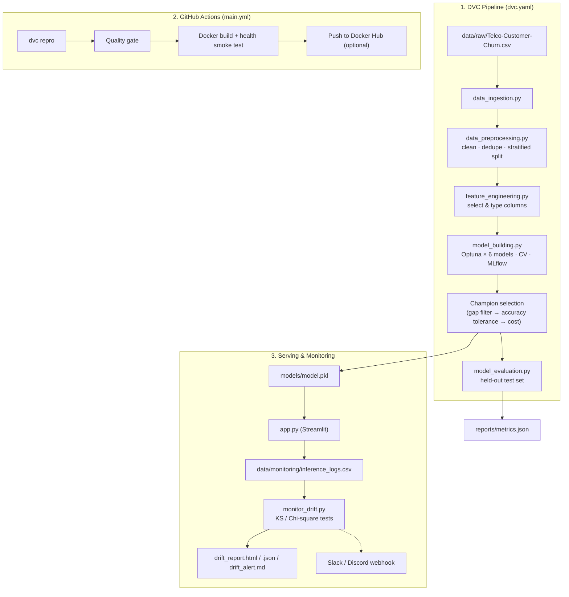

# 📡 Telco Customer Churn Prediction – End-to-End MLOps Pipeline

A reproducible, production-style machine learning system that predicts customer churn for a telecom company. It covers the full lifecycle: **data versioning (DVC) → leakage-free preprocessing → Bayesian hyperparameter search across 6 models (Optuna + MLflow) → rule-based champion selection → held-out evaluation → CI quality gates → Docker/Streamlit serving → statistical data-drift monitoring**.

🌐 **Live demo:** [Telco Churn Prediction & MLOps Dashboard](https://telco-customer-churn-ml-end-to-end-mlops-pipeline-appuction-sy.streamlit.app/)

---

## 📊 Results at a Glance

| Metric (held-out test set) | Value |
| --- | --- |
| Champion model | **Gradient Boosting** |
| Accuracy | **0.7986** |
| ROC-AUC | **0.8414** |
| F1 (churn class) | 0.5719 |
| Precision / Recall (churn class) | 0.6540 / 0.5081 |
| Avg. precision (PR-AUC) | 0.6596 |
| Train − Validation accuracy gap | 0.55 pp |
| Model size / predict latency | 0.45 MB / ~5.6 ms |

**Dataset:** IBM Telco Customer Churn – 7,043 customers, 20 features + target, ~26.5 % churn rate. Split 80/20 (stratified, `random_state=42`) after dropping the ID column and duplicate rows.

---

## 🏛️ Architecture



---

## 📁 Project Structure

```
├── .devcontainer/devcontainer.json     # GitHub Codespaces / VS Code dev container
├── .dvc/                               # DVC configuration
├── .github/workflows/main.yml          # CI/CD: DVC repro, quality gate, Docker build, smoke test, push
├── data/
│   ├── raw/Telco-Customer-Churn.csv    # Source dataset
│   ├── ingested/                       # Schema-validated copy
│   ├── processed/                      # train/test splits + X_/y_ feature files
│   └── monitoring/inference_logs.csv   # Append-only production prediction log
├── models/                             # 6 candidate models + model.pkl (champion)
├── reports/                            # Metrics, model comparison, selection rationale, drift reports
├── src/
│   ├── data_ingestion.py               # Load raw CSV and validate schema
│   ├── data_preprocessing.py           # Drop ID/duplicates, clean TotalCharges, stratified split
│   ├── feature_engineering.py          # Column selection, type casting, X/y separation
│   ├── model_building.py               # Optuna search, CV, MLflow logging, champion selection
│   ├── model_evaluation.py             # Final evaluation on the held-out test set
│   └── monitor_drift.py                # Inference logging, drift detection, alerting
├── tests/                              # pytest suite (data, model, monitoring)
├── app.py                              # Streamlit web app (3 tabs)
├── Dockerfile                          # Non-root, health-checked container
├── dvc.yaml / dvc.lock                 # Pipeline definition and reproducibility lock
├── params.yaml                         # All tunable pipeline and selection parameters
├── model.pkl                           # Root-level champion copy for Streamlit Cloud
├── requirements.txt                    # Serving / CI dependencies
└── requirements-dvc.txt                # Full training + DVC + MLflow + pytest dependencies
```

---

## ⚡ Core Features

### 1. Reproducible pipeline with DVC
Five declarative stages — `data_ingestion → data_preprocessing → feature_engineering → model_building → model_evaluation` — are defined in `dvc.yaml`. DVC hashes dependencies, parameters and outputs (`dvc.lock`), so unchanged stages are skipped and results are reproducible with one command:

```bash
dvc repro
```

### 2. Leakage-free modelling
All preprocessing lives **inside** each scikit-learn `Pipeline`, so it is fit only on the training folds during cross-validation:

```
ColumnTransformer
 ├─ numeric:     median imputer → StandardScaler / MinMaxScaler
 └─ categorical: most-frequent imputer → OneHotEncoder(handle_unknown="ignore")
→ SelectKBest(f_classif, k)
→ Classifier
```

The test set is only touched once, in `model_evaluation.py`.

### 3. Multi-model Bayesian search + MLflow tracking
Optuna (30 trials per model, 5-fold stratified CV) tunes six model families – **KNN, Decision Tree, SVM, Gaussian NB, Random Forest, Gradient Boosting** – including the scaler type and the number of selected features. Trials whose train/validation gap is too large are penalised so the search steers away from overfitting. Every run is logged to MLflow (experiment `Telco_Churn_DVC_Pipeline`).

### 4. Rule-based champion selection
Configured in `params.yaml → selection`:

1. **Hard overfitting filter** – train − validation accuracy must be **< 5.0 pp**.
2. **Accuracy tolerance** – models within **1.0 pp** of the best eligible validation accuracy become finalists.
3. **Weighted operational cost** (min-max normalised, lower is better):

   `Cost = 0.4 × ModelSize + 0.3 × TrainTime + 0.3 × PredictLatency`

| Model | Size (MB) | Train (s) | Predict (ms) | Train Acc % | Val Acc % | Gap % | Status |
| --- | --- | --- | --- | --- | --- | --- | --- |
| **Gradient Boosting** | 0.4546 | 0.7434 | 5.6149 | 81.29 | **80.73** | 0.55 | 🏆 Champion |
| SVM | 0.5102 | 1.9748 | 6.4418 | 81.18 | 80.43 | 0.75 | Finalist (runner-up) |
| Random Forest | 1.5587 | 0.8206 | 28.5234 | 82.37 | 80.64 | 1.73 | Finalist (runner-up) |
| Decision Tree | 0.0231 | 0.0836 | 5.8219 | 81.64 | 79.68 | 1.96 | Below accuracy tolerance |
| KNN | 0.8230 | 0.0824 | 6.2287 | 81.14 | 79.18 | 1.96 | Below accuracy tolerance |
| Gaussian NB | 0.0089 | 0.0594 | 5.4738 | 76.42 | 76.46 | −0.04 | Below accuracy tolerance |

> Timing columns vary slightly between runs and machines; the full, current table is regenerated in `reports/model_comparison.md` on every `dvc repro`.

### 5. CI/CD with quality gates (GitHub Actions)
`.github/workflows/main.yml` runs on every push / PR to `main` (and manually):

| Job | Steps |
| --- | --- |
| **train** | Install deps → `dvc repro` → `dvc metrics show` → publish model comparison to the job summary → **quality gate** → upload model & report artifacts |
| **docker** | Download artifacts → build image → **container smoke test** (polls `/_stcore/health`) → push to Docker Hub (only on `push` when secrets exist) |

The quality gate fails the build if test accuracy is below `MIN_ACCURACY` (0.73), if the champion's gap is ≥ 5 pp, or if no model satisfied the gap rule (fallback used).

### 6. Production monitoring & drift detection
`app.py` logs every live prediction to `data/monitoring/inference_logs.csv`. `src/monitor_drift.py` compares those inputs against the training baseline (`data/processed/train.csv`) across all 19 input features:

* **Numeric features:** Kolmogorov–Smirnov test
* **Categorical features:** Chi-square test
* A feature is flagged at **p < 0.05**; the dataset is flagged as drifted when **≥ 50 %** of features drift.

Outputs: `reports/drift_report.json`, `reports/drift_report.html` (visual dashboard) and `reports/drift_alert.md` (incident summary). If `ALERT_WEBHOOK_URL` (or `SLACK_WEBHOOK_URL`) is set, an alert is posted to your Slack/Discord webhook.

---

## 🚀 Quickstart

### 1. Set up the environment
```bash
git clone https://github.com/kiran1864/Telco-Customer-Churn-ML-End-to-End-MLOps-Pipeline-Production-System.git
cd Telco-Customer-Churn-ML-End-to-End-MLOps-Pipeline-Production-System

python -m venv myenv
# Windows:      myenv\Scripts\activate
# Linux/macOS:  source myenv/bin/activate

pip install -r requirements-dvc.txt      # training + DVC + MLflow + pytest
```
Python 3.11 is recommended (used in CI, Docker and the dev container).

### 2. Run the pipeline
```bash
dvc repro            # ingest → preprocess → features → train/select → evaluate
dvc metrics show     # print held-out test metrics
```

### 3. Inspect experiments
```bash
mlflow ui            # open http://localhost:5000
```

### 4. Run the tests
```bash
pytest tests/ -v
```
Covers data schema and split integrity, model loading / inference / probabilities / determinism, and drift-monitoring logic (logging, drift detection, alert generation, graceful webhook failure).

### 5. Run drift monitoring
```bash
python src/monitor_drift.py --generate-sample-data   # normal sample traffic
python src/monitor_drift.py --simulate-drift         # deliberately shifted traffic
python src/monitor_drift.py --fail-on-drift          # exit code 1 if dataset drift is detected (CI-friendly)
python src/monitor_drift.py --webhook-url <URL>      # send alert to Slack/Discord
```
Then open `reports/drift_report.html` or read `reports/drift_alert.md`.

### 6. Launch the app
```bash
streamlit run app.py
```
Open <http://localhost:8501>:

* **🔮 Churn Prediction** – enter a customer profile and get a churn probability.
* **📊 Model & Selection** – test metrics, champion rationale and the candidate comparison table.
* **📉 Data Drift** – view logged inference traffic and run drift detection on demand.

---

## 🐳 Docker

The image uses `python:3.11-slim`, installs only the lightweight serving dependencies, runs as a non-root user (`appuser`) and includes a health check against `/_stcore/health`.

```bash
docker build -t telco-churn-mlops-app .
docker run -d -p 8501:8501 --name telco-churn-app telco-churn-mlops-app
docker ps          # check the container reports "healthy"
```
The build expects `models/model.pkl` and `data/processed/train.csv` (both produced by `dvc repro`). Visit <http://localhost:8501>.

**CI image publishing (optional):** add `DOCKERHUB_USERNAME` and `DOCKERHUB_TOKEN` as repository secrets and the workflow will push `:latest` and `:<commit-sha>` tags on pushes to `main`.

## ☁️ Streamlit Cloud / Codespaces

* The root-level `model.pkl` is the artifact used for Streamlit Cloud deployment. Because `*.pkl` is git-ignored, add it with `git add -f model.pkl` after retraining.
* `.devcontainer/devcontainer.json` installs the requirements and auto-launches the app in GitHub Codespaces.

---

## ⚙️ Configuration (`params.yaml`)

| Parameter | Default | Purpose |
| --- | --- | --- |
| `test_size` | 0.2 | Held-out test fraction |
| `random_state` | 42 | Global seed |
| `cv_folds` | 5 | Stratified CV folds |
| `n_trials` | 30 | Optuna trials per model |
| `max_k` | 30 | Upper bound for `SelectKBest` features |
| `selection.max_accuracy_gap_pct` | 5.0 | Overfitting hard filter |
| `selection.accuracy_tolerance_pct` | 1.0 | Finalist accuracy window |
| `selection.weights` | 0.4 / 0.3 / 0.3 | Size / train time / predict latency |
| `selection.fallback_if_none_eligible` | `smallest_gap` | Or `error` to stop the pipeline |

---

## 🛠️ Tech Stack

Python 3.11 · scikit-learn · Optuna · MLflow · DVC · Streamlit · SciPy · pandas / NumPy · pytest · Docker · GitHub Actions

## 🗺️ Possible Next Steps

* Run `pytest` as a step in the CI workflow before `dvc repro`.
* Add a scheduled GitHub Actions workflow that runs `monitor_drift.py --fail-on-drift` and triggers retraining.
* Configure a DVC remote (S3 / GCS / DagsHub) to version datasets and models off-repo.
* Add model explainability (SHAP) to the prediction tab.

## 📜 License

Released under the MIT License.
